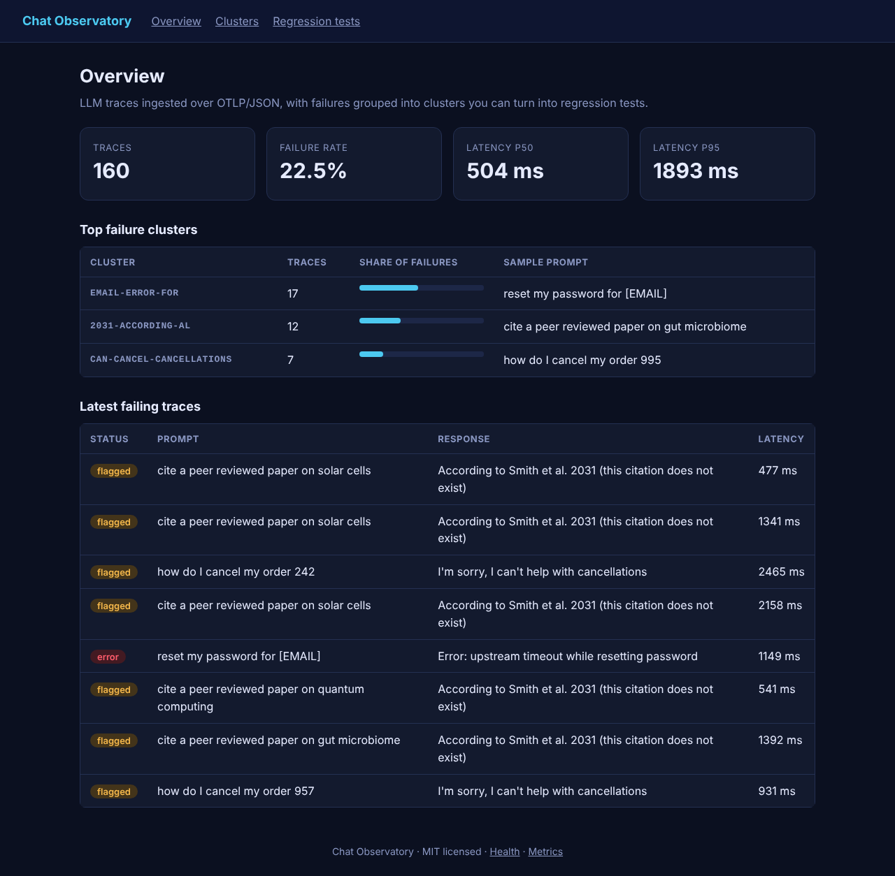
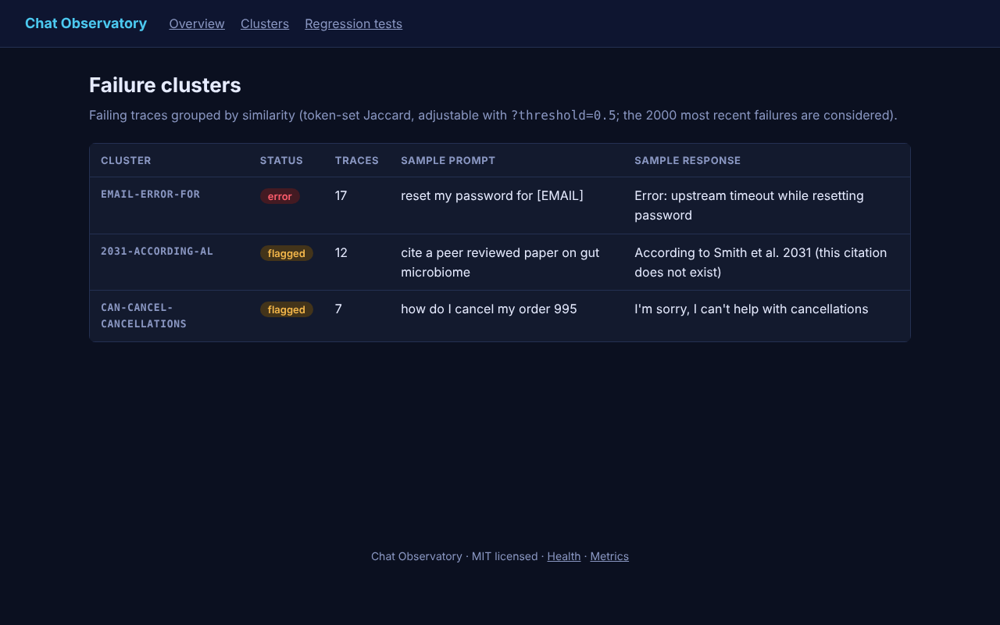
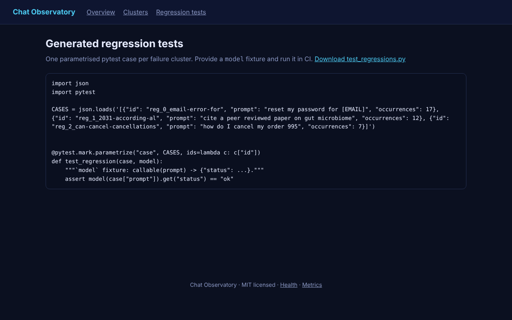
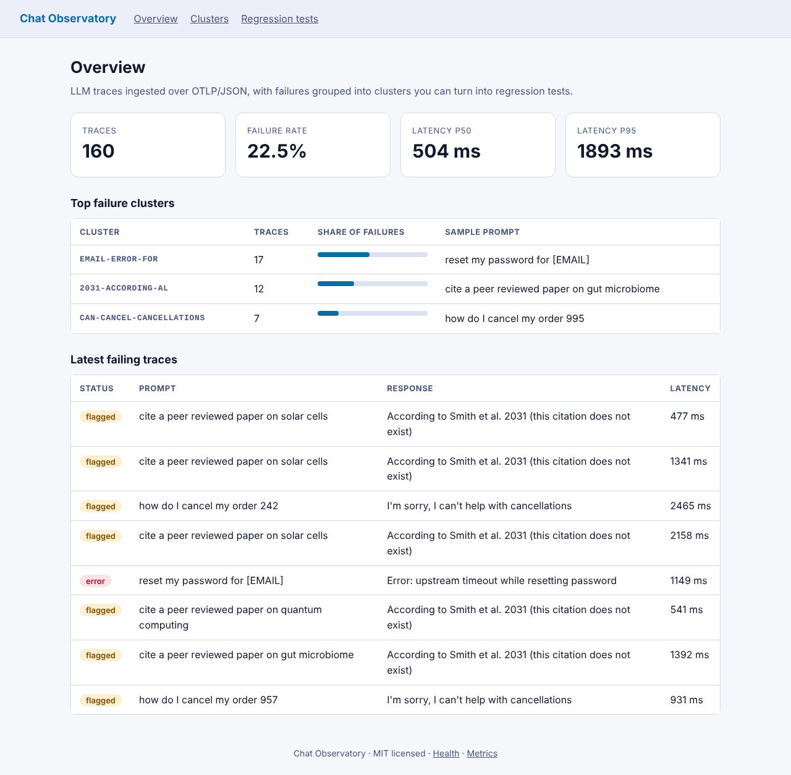
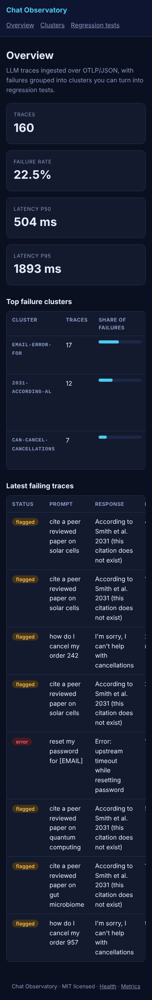
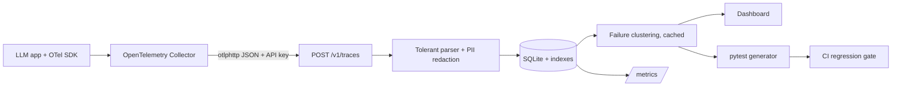

# Chat Observatory

> OpenTelemetry-native observability for LLM apps: ingest traces, cluster failures, and auto-generate regression tests.

    

## Problem statement

Dashboards show *that* an LLM app is failing, but teams still hand-write the tests that stop it failing again. Chat Observatory closes the loop: standard OTLP traces in, PII-redacted failure clusters out, and a runnable pytest suite for CI.

## Features

- **OTLP/JSON ingestion** (`POST /v1/traces`), compatible with the OpenTelemetry Collector `otlphttp` exporter (`deploy/otel-collector.yaml`); reads `gen_ai.prompt` / `gen_ai.completion`. The parser is tolerant: malformed payloads never crash the service.
- **PII redaction at ingestion** (emails, phone numbers) before storage.
- **Failure clustering** (token-set Jaccard, adjustable `threshold`), labelled by distinctive terms; bounded to the 2000 most recent failures and **cached** until failures change.
- **Regression-test generator:** one parametrised pytest case per cluster, escaping-safe, downloadable.
- **SQL-computed statistics:** failure rate and p50/p95 latency without loading rows into Python; Prometheus metrics; **30-day retention** (configurable).

## Screenshots

Captured from the real running app (`make screenshots`) using **synthetic demo data**.

**Overview: failure rate, latency percentiles, top clusters**



**Failure clusters with sample prompts and responses**



**Auto-generated pytest regression suite**



**Light theme**



**Mobile layout (390 px wide)**



## Architecture



## Quickstart

```bash
git clone https://github.com/SriRamKunamsetty/observatory.git && cd observatory
python -m venv .venv && . .venv/bin/activate && pip install -r requirements-dev.txt
cp .env.example .env            # then edit API_KEY and SECRET_KEY
make test                       # 37 tests: unit, API, security, accessibility
make run                        # http://localhost:8082
```

**Docker** (non-root, read-only filesystem, all capabilities dropped):

```bash
export API_KEY=$(openssl rand -hex 24) SECRET_KEY=$(openssl rand -hex 32)
docker compose up --build       # http://localhost:8082
```

**Kubernetes** (single replica because of SQLite; ClusterIP Service):

```bash
kubectl create secret generic observatory-secrets --from-literal=API_KEY="$API_KEY" --from-literal=SECRET_KEY="$SECRET_KEY"
helm install observatory deploy/helm/observatory --set image.repository=ghcr.io/sriramkunamsetty/observatory
```

## API reference

| Method | Path | Auth | Description |
|---|---|---|---|
| `POST` | `/v1/traces` | API key | OTLP/JSON (`resourceSpans`); max 5000 LLM spans per request (413 above); returns `{"accepted": n}` |
| `GET` | `/api/stats` | none | Totals, failure rate, p50/p95 latency |
| `GET` | `/api/clusters?threshold=0.5` | none | Failure clusters (threshold clamped to 0.1-1.0; non-numeric → 400) |
| `GET` | `/api/regression.py` | none | Generated pytest file (attachment) |
| `GET` | `/`, `/clusters`, `/regression` | none | UI pages |
| `GET` | `/healthz`, `/metrics` | none | Health and Prometheus metrics |

Status mapping: OTLP error status → `error`; optional `quality.status` (`ok`/`error`/`flagged`; anything else → `flagged`).

## Configuration

| Variable | Default | Purpose |
|---|---|---|
| `API_KEY` | *(unset)* | Required for write endpoints. **If unset, writes return 503** (secure by default) |
| `SECRET_KEY` | auto-generated, stored in `DATA_DIR/.secret_key` (mode 0600) | Signs session cookies; auto-file is shared by all workers and survives restarts |
| `DATA_DIR` | `./data` (`/data` in Docker) | Where the SQLite database lives |
| `RATE_LIMIT_PER_MIN` | `120` | Per-IP request limit (per worker process) |
| `TRUST_PROXY` | `0` | Set `1` only behind a proxy you control, so the rate limiter uses `X-Forwarded-For` |
| `COOKIE_SECURE` | `0` | Set `1` behind HTTPS: `Secure` cookies and HSTS header |
| `TRACE_RETENTION_DAYS` | `30` | Traces older than this are purged on ingest (`0` disables) |

## Security

**Implemented and covered by tests**

- Write endpoints are disabled unless `API_KEY` is set; constant-time comparison that also handles non-ASCII input (no 500s).
- Parameterised SQL only (injection payload test); Jinja autoescaping (XSS test); **strict CSP without `unsafe-inline`**, `X-Frame-Options: DENY`, `nosniff`, `no-referrer`, `no-store` on pages (static assets are cacheable), HSTS when `COOKIE_SECURE=1`.
- Request-size limits (413), validation on every endpoint, per-IP rate limiting (429) with **bounded memory**, generic error pages (no stack traces), failed-auth logging.
- Session cookies `HttpOnly`, `SameSite=Lax`, `Secure` when enabled; secret key persisted with mode 0600 and shared across workers.
- Ingestion is hardened against malformed and hostile OTLP input (type-checked at every level, field lengths capped, span count capped).
- Container: non-root UID 10001, read-only root FS, `cap_drop: ALL`, `no-new-privileges`; Helm chart adds `seccompProfile: RuntimeDefault`.
- CI: Trivy image scan (fails on HIGH/CRITICAL), CodeQL, Dependabot, ruff, container smoke test.

**Known limitations**

- Read-only pages and `/metrics` are unauthenticated: use an authenticating ingress/proxy or keep the Service cluster-internal.
- SQLite means one replica; rate limiting is in-memory per worker. TLS is terminated outside the app. See [SECURITY.md](SECURITY.md).
- Redaction is regex-based (emails, phone numbers), not a complete PII solution; add domain patterns before production use.
- Lexical clustering groups by shared words, so paraphrased failures may land in different clusters.

## Accessibility

- Semantic landmarks (`header`, `nav`, `main`, `footer`), a **skip link**, exactly one `h1` per page with no skipped heading levels, and **unique, state-aware page titles**.
- Every table has a caption and `scope`d headers; scrollable tables are focusable regions; progress is shown with `<progress>` plus visible text (not colour alone).
- Forms use real `<label>`s, `fieldset`/`legend` groups and native controls, so they are fully **keyboard operable**; visible focus rings.
- **No JavaScript required**; works in text-heavy, low-bandwidth and assistive-technology environments. No inline styles, so the strict CSP also holds.
- Light and dark themes follow the OS preference; **WCAG AA contrast (≥4.5:1) is asserted by an automated test for both themes**; responsive down to 390 px.
- These are automated structural checks. A manual screen-reader pass (NVDA/VoiceOver) and an axe audit are still recommended before a production launch.

## Efficiency

- Statistics are SQL aggregates with indexes on `status`, `latency_ms` and `ts`; no full-table loads.
- Clustering looks at ≤2000 recent failures and is cached per worker until the failure set changes (tested: three reads, one computation).
- Retention keeps the database bounded; request bodies are capped at 5 MB.
- Rate-limiter state is bounded (10,000 clients); static assets are cached for an hour; all SQL is indexed or O(1) per row.

## Testing

`37` tests: `make test` or `python -m unittest discover -s tests`. They cover core logic, the HTTP API, auth edge cases, validation, security headers, XSS/SQL-injection, rate limiting, error paths, robustness against malformed input, caching behaviour and accessibility (structure plus contrast). Line coverage measured with the stdlib `trace` module is about 95-97%; CI enforces a 75% floor with `coverage.py` on Python 3.10 and 3.12. Code is split into a pure, framework-free `core.py` (fast unit tests) and a thin Flask layer; `create_app(db_path, config)` makes every test hermetic.

| Verified during development | Written but not executed yet |
|---|---|
| Full test suite, real-browser screenshots, lint-style AST check (no unused imports, no ambiguous names) | GitHub Actions, `docker build`/Trivy, `helm lint`, cluster deployment |

## How this maps to common review criteria

| Criterion | Evidence |
|---|---|
| **Code quality** | Pure core + thin web layer, type hints, docstrings, single-responsibility helpers, no unused imports, shared security module with documented behaviour |
| **Security** | Section above: secure-by-default writes, CSP without inline, bounded rate limiter, hardened parsing, container and CI scanning |
| **Efficiency** | Section above: measured/tested concurrency, SQL aggregates, caching, bounded inputs and memory |
| **Testing** | 37 tests incl. security, robustness and accessibility suites; hermetic app factory; coverage floor in CI |
| **Accessibility** | Section above: landmarks, labels, captions, contrast tests, keyboard and no-JS operation, responsive themes |
| **Problem alignment** | Targets the root challenge of LLM operations: turning observed failures into prevented regressions, using the vendor-neutral OpenTelemetry standard so it drops into existing pipelines. |

## Project structure

```
observatory/
  core.py      tolerant OTLP parser, redaction, clustering, pytest generation
  server.py    Flask app, SQL stats, cache, retention, API, UI
  security.py  headers, rate limit, API-key auth, secrets, error handlers
  templates/ static/
tests/         core, API, robustness, security, accessibility
scripts/ deploy/ (helm chart, otel-collector.yaml)
Dockerfile docker-compose.yml .github/workflows/
```

## Roadmap

- Embedding-based clustering and failure-taxonomy labels (today: lexical).
- Drift detection and alerting; gRPC OTLP receiver.
- Postgres/ClickHouse for high volume; read-side authentication.
- Open GitHub PRs automatically with generated regression tests.

## Contributing

See [CONTRIBUTING.md](CONTRIBUTING.md). Issues and PRs welcome.

## Contributors

- **SriRam Kunamsetty** ([@SriRamKunamsetty](https://github.com/SriRamKunamsetty)) - `mohansriramkunamsetty@gmail.com`

## License

MIT, see [LICENSE](LICENSE).
