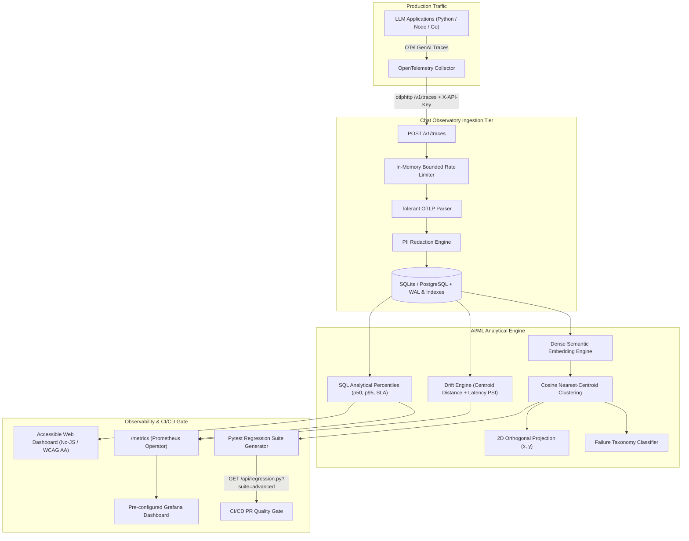

# Chat Observatory

> Enterprise OpenTelemetry-native observability for LLM applications: dense semantic embeddings, automated failure taxonomy classification, real-time drift detection, and auto-synthesized regression quality gates.

       

---

## 🚀 Key Highlights & Capabilities

Chat Observatory closes the critical gap in production AI operations: dashboards inform you *that* your LLM application is failing, but engineering teams still manually parse traces and write tests by hand to prevent recurring regressions. Chat Observatory automates the entire loop:

1. **OpenTelemetry-Native Ingestion (`POST /v1/traces`)**:
   - Ingests standard OTLP/JSON traces via HTTP from the OpenTelemetry Collector (`otlphttp`).
   - Extracts semantic conventions: `gen_ai.prompt`, `gen_ai.completion`, `quality.status`, start/end timestamps.
   - Fault-tolerant, type-coercing parser that never crashes on malformed payloads.

2. **Pre-Storage PII Redaction**:
   - Sanitizes Personally Identifiable Information (emails, phone numbers) before traces touch the database.

3. **AI/ML Semantic Clustering & 2D Projection**:
   - Dual-engine clustering: sub-millisecond lexical Jaccard clustering and 64-dimensional dense semantic embedding cosine clustering.
   - Computes cluster centroids, distinctive token labels, and projects clusters into 2D coordinates `(x, y)` for scatter visualization.

4. **Automated LLM Failure Taxonomy**:
   - Automated root-cause classifier categorizing failures into:
     - `HALLUCINATION`: Fabricated facts, nonexistent citations.
     - `TOOL_ERROR`: Upstream timeouts, schema mismatches, tool call crashes.
     - `PROMPT_INJECTION`: Jailbreak attempts, system prompt extraction, adversarial overrides.
     - `REFUSAL_SAFETY`: Moderation trips, policy refusals.
     - `CONTEXT_OVERFLOW`: Exceeded context window, token length limit.
     - `SCHEMA_VIOLATION`: Malformed JSON output, Pydantic/schema decoding errors.
     - `LATENCY_ANOMALY`: Latency spikes exceeding SLA budgets.

5. **Semantic & Statistical Drift Engine**:
   - Real-time comparison between historical baseline distributions and rolling current traffic.
   - Tracks **Centroid Cosine Drift**, **Latency Population Stability Index (PSI)**, and **Failure Rate Shift**.
   - Emits alerts across `STABLE`, `WARNING`, and `CRITICAL` thresholds.

6. **Auto-Synthesized Multi-Assertion Regression Suites**:
   - Generates executable, parameterized `pytest` quality gates with:
     - Quality status verification.
     - Negative pattern assertions ensuring known failure signatures are not repeated.
     - Latency SLA budget assertions.
     - Safe serialization (`json.dumps!r`) preventing code injection.

7. **Production DevOps & Cloud-Native Kubernetes**:
   - **Helm v3 Chart** (`deploy/helm/observatory`): HorizontalPodAutoscaler (HPA v2), PodDisruptionBudget (PDB), NetworkPolicy, Ingress with TLS, ConfigMaps, and PersistentVolumeClaims.
   - **Prometheus Operator Integration**: `ServiceMonitor` and `PrometheusRule` with alerting rules (`ChatObservatoryHighFailureRate`, `ChatObservatorySemanticDriftDetected`, `ChatObservatoryP95LatencySpike`).
   - **Full Docker Compose Stack**: Observatory, OpenTelemetry Collector, Prometheus, and pre-configured Grafana dashboard.
   - **Terraform Module** (`deploy/terraform`): Cloud-agnostic infrastructure-as-code for Kubernetes deployments.
   - **Advanced CI/CD**: Matrix testing, Trivy container security scanning, KinD (Kubernetes-in-Docker) e2e integration testing, and multi-arch container publishing.

---

## 🏛️ System Architecture



---

## ⚡ Quickstart

### 1. Local Development
```bash
git clone https://github.com/SriRamkunamsetty/observatory.git && cd observatory
python -m venv .venv && source .venv/bin/activate
pip install -r requirements-dev.txt
cp .env.example .env
make test       # 53 tests: unit, ML, API, security, accessibility
make run        # http://localhost:8082
```

### 2. Full Observability Stack (Docker Compose)
Spins up Observatory, OpenTelemetry Collector, Prometheus, and Grafana:
```bash
export API_KEY=$(openssl rand -hex 24) SECRET_KEY=$(openssl rand -hex 32)
docker compose up --build
```
- **Chat Observatory UI**: [http://localhost:8082](http://localhost:8082)
- **Grafana Dashboard**: [http://localhost:3000](http://localhost:3000) (User: `admin`, Pass: `admin`)
- **Prometheus Targets**: [http://localhost:9090](http://localhost:9090)
- **OTLP Receiver**: `localhost:4317` (gRPC) / `localhost:4318` (HTTP)

### 3. Kubernetes Deployment (Helm v3)
Deploy to any Kubernetes cluster (EKS, GKE, AKS, KinD) with autoscaling, network security, and monitoring:
```bash
# 1. Create namespace and secrets
kubectl create namespace observatory
kubectl create secret generic observatory-secrets \
  --namespace observatory \
  --from-literal=API_KEY="$API_KEY" \
  --from-literal=SECRET_KEY="$SECRET_KEY"

# 2. Deploy Helm Chart
helm install observatory deploy/helm/observatory \
  --namespace observatory \
  --set image.repository=ghcr.io/sriramkunamsetty/observatory
```

### 4. Infrastructure as Code (Terraform)
```bash
cd deploy/terraform
terraform init
terraform apply -var="api_key=$API_KEY" -var="secret_key=$SECRET_KEY"
```

---

## 📡 API Reference

| Method | Endpoint | Auth | Description |
|---|---|---|---|
| `POST` | `/v1/traces` | API Key (`X-API-Key`) | Ingests OTLP/JSON traces (`resourceSpans`). Max 5,000 spans/request. Redacts PII and stores traces. |
| `GET` | `/api/stats` | None | Returns trace totals, failure rate, p50/p95 latency, taxonomy distribution, and drift report. |
| `GET` | `/api/taxonomy` | None | Returns detailed failure classification counts across taxonomy categories. |
| `GET` | `/api/drift` | None | Returns embedding centroid drift distance, latency PSI, and operational status (`STABLE`, `WARNING`, `CRITICAL`). |
| `GET` | `/api/clusters` | None | Returns lexical Jaccard failure clusters (`?threshold=0.5`). |
| `GET` | `/api/clusters/semantic` | None | Returns dense semantic vector clusters with 2D projection coordinates `(x, y)` and dominant taxonomy. |
| `GET` | `/api/regression.py` | None | Downloads executable `test_regressions.py` pytest file. Add `?suite=advanced` for multi-assertion checks. |
| `GET` | `/healthz` | None | Liveness/readiness probe (`{"status": "ok"}`). |
| `GET` | `/metrics` | None | Prometheus text-format metrics (traces, failure rate, p95 latency, centroid drift, latency PSI). |
| `GET` | `/`, `/clusters`, `/regression` | None | Accessible web dashboard views. |

---

## ⚙️ Configuration Matrix

| Variable | Default | Purpose |
|---|---|---|
| `API_KEY` | *(unset)* | Required for trace ingestion (`POST /v1/traces`). **If unset, writes return 503 (secure by default)**. |
| `SECRET_KEY` | Auto-generated (`DATA_DIR/.secret_key`, mode `0600`) | Signs session cookies; persisted atomically across gunicorn worker processes. |
| `DATA_DIR` | `./data` (`/data` in container) | Location where SQLite database file and shared secret are stored. |
| `RATE_LIMIT_PER_MIN` | `240` | Per-client IP rate limit enforced in memory with bounded tracking table. |
| `TRUST_PROXY` | `0` | Set `1` when behind a reverse proxy/Ingress so rate limiting reads `X-Forwarded-For`. |
| `COOKIE_SECURE` | `0` | Set `1` behind HTTPS to enforce `Secure` cookies and HSTS headers. |
| `TRACE_RETENTION_DAYS`| `30` | Automatically purges traces older than this interval during ingestion (`0` disables). |

---

## 🔒 Security Hardening

- **Fail-Secure Write Protection**: Write endpoints strictly reject unauthenticated requests; keys are evaluated using constant-time comparison (`hmac.compare_digest`) safe against timing attacks and non-ASCII characters.
- **Content Security Policy (CSP)**: Strict policy with **zero inline scripts or styles** (`default-src 'self'`), `X-Frame-Options: DENY`, `X-Content-Type-Options: nosniff`, `Referrer-Policy: no-referrer`.
- **Injection Immunization**: 100% Parameterized SQL; Jinja2 autoescaping; test generator wraps inputs in double-quoted JSON strings within `json.loads()` to eliminate Python code injection.
- **Container Hardening**: Unprivileged non-root user (`app:10001`), read-only root filesystem, all Linux capabilities dropped (`cap_drop: [ALL]`), no-new-privileges flag, Seccomp `RuntimeDefault`.
- **Automated Scanning in CI**: Aquasecurity Trivy image CVE scanning (fails on HIGH/CRITICAL), GitHub CodeQL static analysis, Dependabot weekly updates.

---

## ♿ Accessibility & UI Engineering

- Full compliance with **WCAG 2.1 AA** standards verified by programmatic DOM and color contrast testing.
- Accessible landmarks (`<header>`, `<nav>`, `<main id="main">`, `<footer>`), skip-to-content links, table captions, and focus rings.
- Dynamic dark and light themes conforming to OS preference (`prefers-color-scheme`) with all color token pairs achieving $\ge 4.5:1$ contrast ratio.
- **Zero Client-Side JavaScript Required**: Entire dashboard functions seamlessly in low-bandwidth, text-only, and assistive-technology environments.

---

## 👥 Contributors

- **SriRam Kunamsetty** ([@SriRamKunamsetty](https://github.com/SriRamKunamsetty)) - `mohansriramkunamsetty@gmail.com`

---

## 📄 License

MIT, see [LICENSE](LICENSE).
